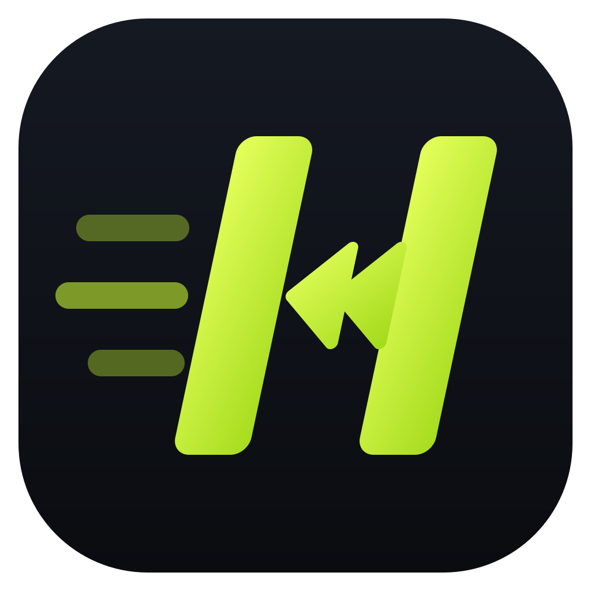
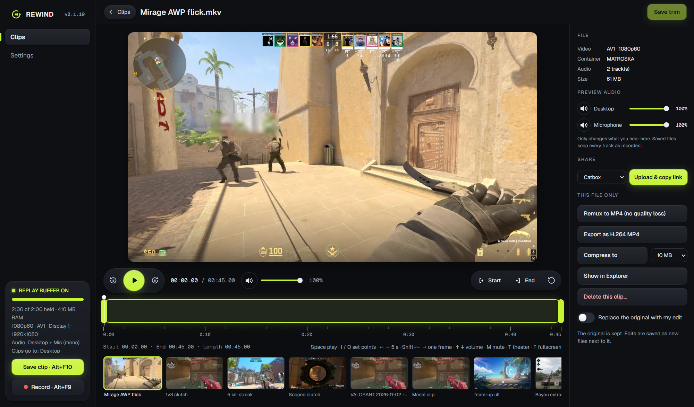
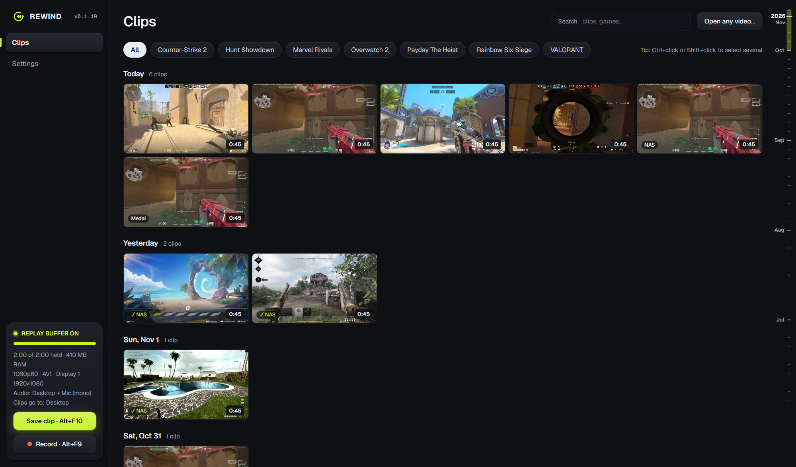
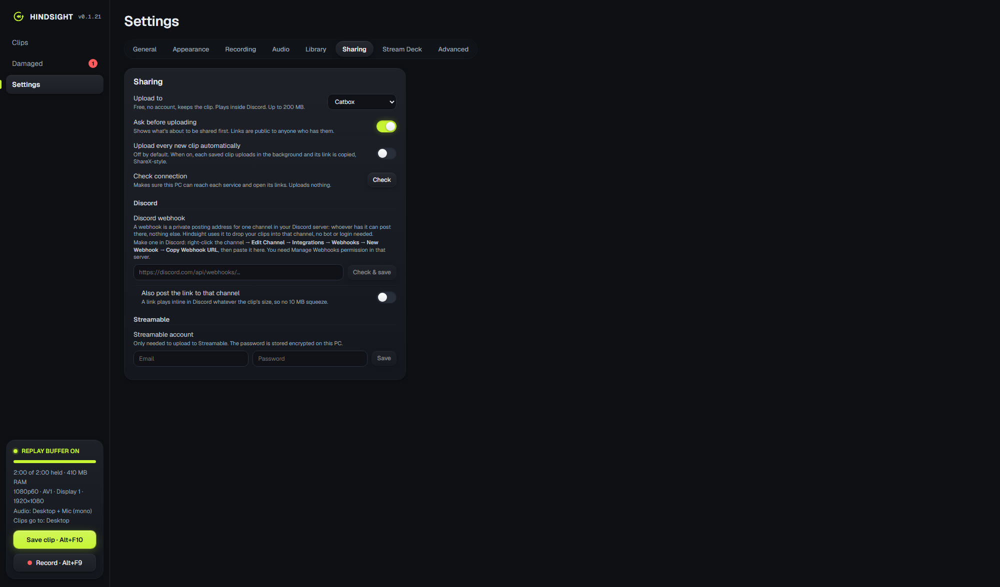
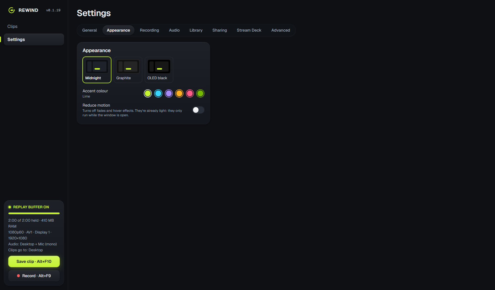

<p align="center">
  
</p>

<h1 align="center">Hindsight <sup><code>BETA</code></sup></h1>

<p align="center">
  <b>The lightweight game clipper for Windows.</b><br />
  Always-on replay buffer on your NVIDIA GPU, a frame-exact trimmer, and one-click sharing that plays inside Discord.
</p>

<p align="center">
  <a href="https://github.com/aattiaibrahim/hindsight/releases/latest"><b>⬇ Download for Windows</b></a>
  &nbsp;·&nbsp;
  <a href="https://aattiaibrahim.github.io/hindsight/">Website</a>
  &nbsp;·&nbsp;
  <a href="benchmarks/README.md">Benchmarks</a>
  &nbsp;·&nbsp;
  <a href="#stream-deck-and-other-tools">Stream Deck</a>
</p>

<p align="center">
  
</p>

<table>
  <tr>
    <td width="50%" valign="top">
      
      <p><b>Your clips, by game and day.</b> Thumbnails first, a date timeline to jump through months, and clips from Medal, OBS and NVIDIA in the same place.</p>
    </td>
    <td width="50%" valign="top">
      
      <p><b>Share in one click.</b> Upload to Catbox, Litterbox, Streamable or a Discord channel and get a link that plays inside Discord, no Nitro needed.</p>
    </td>
  </tr>
  <tr>
    <td width="50%" valign="top">
      
      <p><b>Yours to style.</b> Midnight, Graphite or OLED black, six accent colours, and a Reduce motion switch.</p>
    </td>
    <td width="50%" valign="top">
      <p><b>Light on your game.</b></p>
      <ul>
        <li>Encodes on the GPU's own NVENC chip: about 2.5 ms per frame and around 3% of one CPU core at 1080p60.</li>
        <li>The replay buffer lives in RAM, so no constant SSD writes.</li>
        <li>Saving a 2-minute clip takes under a second.</li>
        <li>A built-in <a href="benchmarks/README.md">performance test</a> measures the cost against OBS, NVIDIA Instant Replay and Medal on your own PC.</li>
      </ul>
      <p>Needs Windows 10/11 and an NVIDIA GTX 10-series or newer (AV1 needs an RTX 40/50). The installer isn't code-signed yet, so SmartScreen may warn you: click <b>More info → Run anyway</b>.</p>
    </td>
  </tr>
</table>
## Features

- **Replay buffer on NVENC**: AV1, HEVC or H.264, 15 s to 20 min, constant-quality mode. **Auto** (the default) asks the driver what your GPU can encode and uses the best: AV1 on an RTX 40/50, else HEVC, else H.264. A saved choice your GPU can't do falls back the same way.
- **Buffer in RAM by default**: no constant SSD writes. A disk mode remains for very long buffers.
- **Tray icon shows a red dot** while capturing, like OBS.
- **Save clip hotkey** (default `Alt+F10`). Clips from a detected game go to `Videos\Hindsight\<Game>\`; everything else goes to `Videos\Hindsight\Desktop\`.
- **Full recording** (default `Alt+F9`, or the Record buttons). It reuses the same capture, so there's no second encoder. A crash mid-recording is recovered on the next start, and recording stops by itself if the disk drops below 1.5 GB free.
- **Clip health check**: finds clips that won't play properly (common with NVIDIA and OBS MP4s after a driver hiccup or crash), marks them in the library, and heals them: you review each one (the part that would be kept plays first) and choose whether to cut it down to its good part, without re-encoding. The original goes to the Recycle Bin; clips on a NAS are never replaced, only copied. It runs only while no game is in front, on the GPU's video decoder, and stops the moment a game starts.
- **Game detection**: known game exes, game-library installs (Steam, Epic, Riot, Xbox, GOG, Ubisoft, EA, Rockstar, Battle.net) and fullscreen apps. Browsers, Discord, launchers and so on count as Desktop. Steam and Epic games get their store names, and a clip saved while you're tabbed out of a game that's still running goes to that game.
- **Capture always runs at below-normal CPU priority**, so games get the CPU first.
- **Win+P safe capture**: the monitor is re-picked within about 1 s after Win+P, a resolution change or a monitor being plugged in. Modes: follow primary, follow cursor, or one fixed monitor.
- **Tray app**: left-click opens a quick flyout (save 30 s / 60 s / full, monitor mode, last clips); right-click shows a menu. Closing the window keeps it running in the tray.
- **Launch with Windows** (starts in the tray), single instance.
- **Library**: clips grouped by day and game, with search, thumbnails, codec and length.
  - Each game shows its own logo (its program's icon, found from the game you played, Steam, Epic, Battle.net and Riot installs). Games saved under different spellings, or folders named after a program file ("SpeciesUnknown-Win64-Shipping"), are offered a merge or a tidy name.
  - **On this day**: clips from this date in earlier years ("1 year ago today") at the top, played straight through in a slideshow.
  - Only the clips near the screen load, newest requests first, and thumbnails and lengths are kept on the app's own folder, so big libraries and clips on a hard drive open quickly. **Prepare thumbnails ahead of time** makes them all in the background while you're not gaming.
  - A NAS icon on each clip: a check when it's safely on the NAS, a minus when it isn't copied yet, an arrow when it's only on the NAS.
- **NAS library** (Settings → Library & NAS):
  - Clips save to this PC first, so saving stays instant and works offline. They then copy in the background to a network folder in the same `<Game>\` layout. Each copy is read back from the NAS and checked byte for byte (SHA-256) against the original before it counts.
  - Several PCs can share one NAS: file names include the PC's name, and clips from other PCs show up in the library.
  - Copying waits until your game is closed (in front or tabbed out of) and stops between files if one starts, so it never costs frames.
  - Optionally, the local copy goes to the Recycle Bin once its NAS copy is checked identical.
  - Progress shows in the sidebar and in Settings: clips and GB left, percent, speed and time left.
  - Edits stay in step: a clip you trim, heal or export in place replaces its NAS copy (verified the same way); the old NAS version is kept in a hidden `.hindsight-replaced` folder for 30 days. Clips that are only on the NAS are never replaced, since a network folder has no Recycle Bin.
  - **Hindsight Server** runs on the NAS (TrueNAS or any Docker host): the library in any browser at home, with share links, montages and "On this day". See [server/README.md](server/README.md).
  - Other recorders' clips (Medal, NVIDIA, OBS) aren't copied until you move them into Hindsight's folders; the setting says so and has a button for it.
- **Clips from other recorders**: Medal, OBS, NVIDIA, Ascent, AMD ReLive, Xbox Game Bar, Outplayed, Insights Capture, SteelSeries Moments and Streamlabs folders are found (from their own settings where they keep them) and shown in the library in place, grouped by game. Nothing is moved or copied. Any other folder can be added too.
- **Duplicates** (Cleanup): the same clip saved in two places (a copy instead of a move, Medal's Clips and Imported, Ascent's Clips and Downloads) is found by size and a fingerprint of its start and end, confirmed by reading it whole. Pick the copy to keep; the others go to the Recycle Bin.
- **Move into Hindsight**: tidies a linked folder into Hindsight's layout (`<Game>\<Game> <date time>`), merging game names across spellings.
  - Same-drive moves are instant renames. Other drives copy, check the size, and only then remove the original.
  - Every move is logged as it happens, so **Undo** puts everything back, even after a crash.
- **Share** (Share on a clip, or the Share box in Studio; set up under Settings → Sharing):
  - Uploads the clip and copies a link. The clip is first turned into an H.264 MP4 that plays inside Discord for everyone, no Nitro needed.
  - **Catbox** (free, no account, permanent, up to 200 MB) and **Litterbox** (free, temporary, up to 1 GB) give direct links that play inline in Discord.
  - A **Discord webhook** posts the clip straight into a channel, compressed under Discord's 10 MB. Links from the other services can be posted there too.
  - **Streamable** needs an account.
  - Optional auto-upload of every new clip, ShareX-style.
  - The webhook address and Streamable password are stored encrypted with Windows DPAPI, never in settings.json.
- **Save sound**: a short chime when a clip or recording is saved, a low tone if it fails (can be turned off).
- **Open any video** from any folder; it shows up under "Imported".
- **Audio tracks in the editor**: each track (desktop sound, microphone, Discord) gets its own lane under the timeline with its waveform, so you can see where the action is. Drag across a lane to mute that part, mute a whole track, or make a track louder or quieter (±20 dB). The changes go into the saved trim, export or compress. **Audio only** saves the trimmed part as an MP3, all tracks mixed or one on its own.
- **Mic volume** (Settings → Recording → Audio): makes the microphone louder or quieter for everything you record, ±20 dB, applied straight away without restarting the buffer.
- **Damaged section**: every clip the health check finds broken, in one place, with the same date timeline as the library. A badge on the sidebar shows how many there are.
- **Studio**: preview, drag in/out handles, one frame-exact **Save trim** that re-encodes only the moment before the first keyframe (under a second) and copies the rest untouched, so it takes a few seconds and keeps full quality.
- **Per-file tools**: change to .mp4 (instant, lossless), export H.264 (plays everywhere), audio only (MP3), compress to 10/25/50/100 MB. Originals are never changed.
- **Montage** (the Montage page): pick a length (30 s to 10 min), which clips (random, a date range, edited or unedited ones), a game, and how much of each clip (the end, where a replay's action usually is, the middle or the start). Then edit it on a Premiere-style timeline: a preview that plays the whole montage with your song, drag clips to reorder, drag their edges to trim, a music track with the song's waveform, and volumes for the clips and the song. It's saved as an H.264 MP4 in `Videos\Hindsight\Montages`.
- **Beta tools** (Settings → About): **Run diagnostics** saves a text file in Downloads with your PC, GPU and driver, Hindsight's settings, status and recent messages (your Windows user name, NAS name, email and webhook are left out) to attach to a bug report. **Report a problem with this clip** in the editor adds that clip's details. A thank-you list for the early users and beta testers.

- **Audio**: desktop sound (track 1), the microphone (mono by default, track 2) and Discord on its own track (track 3, left out of desktop sound, Windows 10 2004 or later), all on by default. Synced to video within about 10 ms. Exports and compresses mix the tracks into one.
- **Replace original** option: trims, exports and compresses overwrite the edited file, and the old one goes to the Recycle Bin.
- **Performance test** (Performance page, shown when **Settings → Advanced → Benchmark mode** is on): compares your game's FPS, 1% lows and GPU time per frame with nothing recording vs Hindsight, OBS replay buffer, NVIDIA Instant Replay and Medal. Hindsight switches each recorder on and off by itself (it opens and closes OBS and Medal, and presses your NVIDIA Instant Replay shortcut), so you just keep playing, and puts them back the way they were afterwards. After a warm-up, runs alternate nothing → recorder → nothing over several rounds in a shuffled order; each recorder is compared with the runs either side of it, and results carry 95% confidence ranges, so differences inside the game's own noise are reported as "no measurable cost". Every run is checked (game in front, the right recorder encoding, nothing else encoding), and it warns about drift, V-Sync, FPS caps, CPU-bound scenes and recorders set to a different resolution, FPS or buffer length. Frame times come from Intel PresentMon. **Share on GitHub** sends your results to the [benchmarks](benchmarks/README.md) page.

## Not yet

- Per-game profiles, more per-app audio tracks, the in-game overlay, text and transitions in montages, and HDR tone-mapping.

## Feedback

Hindsight is in beta. Found a bug? Open a [bug report](https://github.com/aattiaibrahim/hindsight/issues/new?template=bug_report.yml) with the diagnostics file. Have an idea? Open a [feature request](https://github.com/aattiaibrahim/hindsight/issues/new?template=feature_request.yml), or 👍 [one that's already there](https://github.com/aattiaibrahim/hindsight/issues?q=is%3Aissue+label%3A%22feature+request%22).

## How it works (native engine, default)

The pipeline works the same way OBS's does. Everything stays on the NVIDIA GPU, and audio and video share one clock:

1. **Windows Graphics Capture** hands Hindsight each frame as a texture on the GPU that drives the monitor.
2. **The D3D11 Video Processor** converts and resizes it to NV12 on the GPU, at any output size including 4K and 720p.
3. **NVENC, called directly** (`src-tauri/src/native/nvenc.rs`), encodes AV1/HEVC/H.264 with constant quality and a keyframe every second.
4. Encoded packets go into a **RAM ring**, stamped on the shared high-precision clock (QPC).
5. **WASAPI audio** chunks carry Windows' own capture timestamps and go into RAM rings at their exact time on the same clock. Saving cuts video and audio for the same time window, so sync is built in (measured within about ±5 ms) and can't drift.

Measured on an RTX 5080 at 1080p60: about 2.5 ms of GPU encode per frame, about 3% of one CPU core for the whole capture, and a 12 s clip saved in under 1 s. Recordings stream to disk as they go, so a crash leaves parts that are recovered on the next start.

If the native engine can't start (no NVIDIA GPU, driver problem), Hindsight falls back to the FFmpeg engine below. It can also be picked under **Settings → Display & capture → Capture engine**.

## How it works (compatibility engine)

ffmpeg's `ddagrab` captures the monitor on the GPU and feeds frames straight into NVENC, with no CPU copy. Output goes to 2-second MKV segments in a rolling ring. In RAM mode, ffmpeg streams each finished segment to Hindsight over localhost and nothing touches the disk. In disk mode, segments go under `%LOCALAPPDATA%\com.rewind.app\buffer`. Saving joins the newest segments without re-encoding (`-c copy`), so it is instant and lossless.

A supervisor thread (`src-tauri/src/engine.rs`) checks the monitor layout every second. If it changes, or ffmpeg exits, it starts a new capture "generation" on the right monitor. ffmpeg runs in a Windows job object, so it always dies with the app.

## Stream Deck and other tools

- **Stream Deck plugin**: download `Hindsight.streamDeckPlugin` from the [latest release](https://github.com/aattiaibrahim/hindsight/releases/latest) and double-click it. It has four actions:
  - **Save Clip**: full buffer or a set length per key.
  - **Record**: turns red and shows the timer.
  - **Replay Buffer**: on/off.
  - **Clip Quality**: switches resolution and quality per key, e.g. "1080p High" or "4K Max".
- **No plugin needed**: Stream Deck's built-in *Hotkey* action works with `Alt+F10` / `Alt+F9`, or run `Rewind.exe --save-clip [seconds]`, `--toggle-record` or `--toggle-buffer`.
- **Local API** (127.0.0.1:52371 only, header `X-Rewind: 1` required): `GET /status`, `POST /save?seconds=30`, `POST /record/toggle`, `POST /buffer/toggle`, `POST /quality?height=1080&cq=22`.

## Quality

Clip resolution can be **same as screen** (captured fully on the GPU), 4K, 1440p, 1080p or 720p. A different size is resized on the CPU, at about 1–5% CPU. Quality presets are Small / Balanced / High / Max, with a CQ slider for fine-tuning.

## Safety

- An edit only replaces the original after the new file is checked: it must be non-empty, readable and about the right length. The original goes to the Recycle Bin, never straight to deletion.
- Settings are written atomically. A corrupted settings file falls back to defaults and is kept as `settings.json.bak`.
- Settings values are clamped to usable ranges. If a hotkey can't be registered, the previous one is restored.
- Clip names never overwrite an existing file. Saving needs at least 300 MB free.
- ffmpeg runs in a job object, so it can't outlive the app.

## Tests

```powershell
cd src-tauri
cargo test                                   # unit + file-tool tests (needs an NVIDIA GPU)
cargo test live_ -- --ignored --nocapture    # real capture: buffer, clip, recording, recovery
```

## Develop

Requirements: Rust, Node + pnpm, Visual Studio C++ Build Tools, an NVIDIA GPU.

```powershell
powershell -ExecutionPolicy Bypass -File scripts\get-ffmpeg.ps1   # once: LGPL FFmpeg + PresentMon into vendor\
pnpm install
pnpm tauri dev
```

Build an installer with `pnpm tauri build`. It bundles FFmpeg next to the app.

## License notes

Hindsight bundles an LGPL build of FFmpeg and Intel's PresentMon (MIT, for the Performance test). See [THIRD_PARTY_NOTICES.md](THIRD_PARTY_NOTICES.md).
